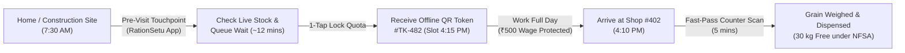
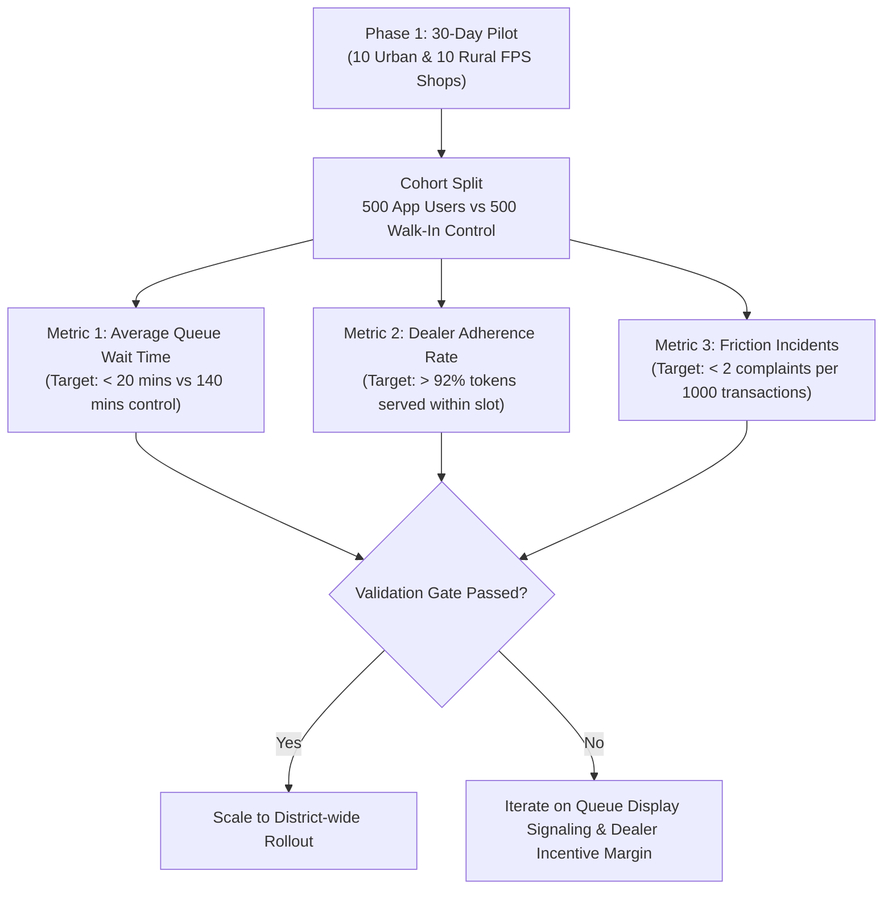

# RationSetu (राशन सेतु): Design Thinking Prototype Framework

> **Case Study & System Design for the Public Distribution System (PDS)**  
> **Workspace:** `/Users/sakshikumari/Downloads/Design Thinking`  
> **Interactive Prototype:** [index.html](file:///Users/sakshikumari/Downloads/Design%20Thinking/index.html)  

---

## Executive Summary

The Public Distribution System (PDS) provides food grains (Rice, Wheat, Coarse Grains, Sugar) to over 800 million citizens under the National Food Security Act (NFSA) and Antyodaya Anna Yojana (AAY). Despite nationwide digitization (e-PoS machines, Aadhaar seeding, ONORC), the **last-mile human experience** remains fraught with anxiety, wage loss, and unpredictability.

This prototype addresses the three foundational Design Thinking questions:
1. **User Interaction Point:** Where and when does the user interact with the system?
2. **The Single Element:** Which exact UI/UX element addresses the user's primary difficulty?
3. **The Core Unknown:** What is the critical assumption we do not yet know will work in the real world?

---

## 1. User Interaction Point (Touchpoint Architecture)



### Context & Persona
- **Persona:** *Ramesh Kumar (44)*, daily-wage construction laborer in an urban-fringe settlement.
- **Family:** 4 members (Spouse, 2 school-going children).
- **Category:** Antyodaya Anna Yojana (AAY) - Entitled to 35 kg food grains monthly.
- **Economic Reality:** Earns ₹450–₹550 per day. If he takes half a day off to stand in a ration queue, he loses 100% of that day’s earnings.

### The Defined Interaction Point: The "Pre-Commute Smart Touchpoint"
- **Timing:** *Pre-travel* (Before the beneficiary leaves home or job site).
- **Physical Channel:** Beneficiary’s low-cost Android smartphone (or shared family smartphone / Common Service Center kiosk / IVR missed-call auto-response).
- **Why this touchpoint is decisive:**
  In traditional PDS, the user interacts **only after physically arriving at the shop**. By shifting the interaction touchpoint **upstream (pre-commute)**, the user moves from *passive suffering* to *active schedule control*.

---

## 2. Which Single Element Addresses the User's Difficulty?

### The Core Difficulty: "Asymmetric Information & Lost Livelihood"
Beneficiaries endure three interlocked friction points:
1. **Stock Uncertainty:** Traveling 2–5 km only to be told: *"Stock khatam ho gaya, agle hafte aao"* (Stock is finished, come next week).
2. **Shop Closure Uncertainty:** Finding the Fair Price Shop randomly shut during supposed operating hours.
3. **Queue Time Trap:** Unpredictable 2–4 hour physical queues that wipe out daily wage work.

### The Single Element: The "Guaranteed Stock & Fast-Pass Token Card"
Inside the prototype, this is the **prominent hero card on the home screen** (`#heroSingleElementCard`).

```
┌────────────────────────────────────────────────────────┐
│ 🟢 OPEN (Till 7 PM)      ⭐ CORE ELEMENT: LIVE STATUS   │
│ Current Wait: ~12 mins   Stock: 100% (Rice: 20kg, Wheat: 10kg) │
├────────────────────────────────────────────────────────┤
│ October 2026 Quota Balance: 30 kg Remaining (Free ₹0)  │
│ [ Rice: 20 kg ]   [ Wheat: 10 kg ]   [ Sugar: 1 kg ]   │
├────────────────────────────────────────────────────────┤
│ Select Fast-Track Slot:                                │
│ [ Today 4:00 - 4:30 PM (4 left) ]  [ 5:30 - 6:00 PM ]  │
│                                                        │
│ [  🎟️ LOCK MY QUOTA & GET FAST-PASS TOKEN  ]          │
└────────────────────────────────────────────────────────┘
```

#### Why This Specific Element Solves the Difficulty:
1. **Collapses 4 Information Silos into 1 Screen:** Replaces rumors with verified live dealer inventory (queried directly from the State Food Logistics ERP).
2. **Guaranteed 24-Hour Stock Reservation:** When Ramesh clicks *"Lock My Quota"*, 30 kg of grain is earmarked in the dealer's e-PoS database. The dealer cannot sell Ramesh's allocation to black-market bulk buyers under the pretense that Ramesh never showed up.
3. **Bilingual Visual Cards:** High-contrast, vernacular visual cards with icons and color coding, allowing semi-literate beneficiaries to see exact quantities and timings without confusion.
4. **Offline Asymmetric QR Token:** Generates a tamper-proof cryptographically signed token (`#TK-482`) that functions even if the shop has zero cellular network.

---

## 3. What is the One Thing We Do Not Yet Know Will Work?

### The Critical Untested Assumption (Riskiest Hypothesis)
> **"Will Fair Price Shop (FPS) dealers reliably honor scheduled digital time-slot tokens when pressured by an aggressive, non-digital crowd waiting physically outside in the heat?"**

### Why this is the pivotal unknown:
If a dealer says: *"I don't care about your mobile app, look at these 50 people standing since 6 AM; go stand at the back of the line,"* the entire value proposition collapses instantly. Trust in the app is destroyed on day one.

### Secondary Related Unknowns:
1. **Biometric e-PoS Scanner Downtime:** Construction workers with worn fingertips (scratched papillary ridges) suffer up to 35% fingerprint rejection rates at e-PoS counters. Will dealers turn them away?
2. **Digital Divide & Walk-In Backlash:** Will non-smartphone beneficiaries perceive digital token holders as "queue jumpers" or "VIPs", provoking social friction at the village counter?

---

## 4. De-Risking Mechanisms Built Into the Prototype

The prototype incorporates explicit systemic solutions to test and resolve these unknowns:

| Unknown Risk Factor | Prototype Solution / Test Feature | Where to Test in App |
| :--- | :--- | :--- |
| **Walk-In Crowd Friction** | **Hybrid 70/30 Dynamic Queue Protocol:** Dealer e-PoS alternates: 1 digital token holder is served for every 2 physical walk-in beneficiaries. The digital queue display screen outside announces incoming tokens transparently. | Click **"Test Friction (Scenario A)"** |
| **Biometric Scanner Failure** | **Multi-Tier Identity Fallback:** If fingerprint match fails 3 times, e-PoS automatically falls back to: (1) Front-camera Iris scan, (2) One-Time Guardian SMS OTP, or (3) Co-beneficiary family member confirmation. | Click **"Test Fallback (Scenario B)"** |
| **Zero Internet / Network Down** | **Offline ECDSA Public-Key Verification:** The QR token is cryptographically signed offline by the State Food Department. The dealer's e-PoS verifies authenticity locally without 4G/5G data. | Toggle **"Offline Mode"** |
| **Dealer Denial of Quota** | **1-Tap Geo-Verified Food Inspector SOS:** Beneficiary taps *"Report SOS"*, which immediately logs a GPS-stamped audit ticket to the District Food Supply Officer (DFSO). | Click **"Report SOS"** |

---

## 5. Field Pilot & Validation Protocol (Test Plan)

To empirically validate the hypothesis in the real world:



### Quantitative Success Criteria:
1. **Beneficiary Wage Preservation:** \> 80% reduction in total time spent acquiring monthly grains (from 3.2 hours down to 22 minutes).
2. **Dealer Compliance Score:** \> 90% of token holders served within 20 minutes of their scheduled window.
3. **Zero False Denials:** 100% of eligible beneficiaries with worn fingerprints successfully authenticate via multi-tier fallback.

---

## 6. Additional Inclusive Accessibility & Support Features

### A. Multi-Shop Discovery & One Nation One Ration Card (ONORC)
Beneficiaries are no longer tethered to a single corrupt or closed dealer. Under ONORC, the prototype displays 5 nearby Fair Price Shops with real-time distance, walk times, and crowd congestion:
1. **Shop #402: Sharma Fair Price Store** (1.2 km, 14 min walk) — *Your Assigned FPS* (Queue: 8 people, Stock: 100%)
2. **Shop #108: Metro Depot PDS Center** (600 m, 7 min walk) — *ONORC Fast-Pass Available* (Queue: 3 people, Stock: 92%)
3. **Shop #330: Mahila Samiti SHG Ration Kendra** (850 m, 10 min walk) — *All-Women Self-Help Group FPS* (Queue: 5 people, Stock: 88%)
4. **Shop #215: Jan Aahar Kendra (Civil Hospital Gate)** (1.7 km, 20 min walk) — *Transit Hub FPS* (Queue: 14 people, Stock: 76%)
5. **Shop #512: Old Railway Mandi Cooperative** (2.3 km, 28 min walk) — *Large Wholesale Hub* (Queue: 24 people, Stock: 95%)

### B. Offline SMS Booking for Non-Smartphone Users (Feature Phone Inclusion)
To bridge the digital divide for families without smartphones:
- **Toll-Free Shortcode:** `56070`
- **SMS Syntax:** `RATION 072094812094 BOOK 402 4PM`
- **Instant Reply SMS:** *"Your Ration Token #TK-482 is confirmed for Shop #402 at 4:15 PM today. Quota 30kg locked. Show this SMS at counter."*
- Tested live in prototype via the **"Book via Offline SMS (Feature Phone)"** button.

### C. 24x7 Government Helpline & Grievance Redressal Channels
Directly accessible from the bottom bar and modal dialog:
- **National PDS Toll-Free Helpline:** `1967` (Free nationwide, 24x7)
- **State Consumer Helpdesk:** `1800-180-2087` (Free, 8 AM – 8 PM)
- **Local DFSO Inspector Direct Line:** `+91 94120 48210` (Direct grievance escalation)
- **Official Grievance Redressal Email:** `grievance.pds@nic.in`

### D. Interactive Map Navigation
- Stylized vector SVG district map showing user's current GPS position, all 5 shops, and dynamic walking route polylines.
- Real-time turn-by-turn walking distance & ETA indicators.

---

## 7. 3-Member Presentation Guide (For Teachers & Juries)

| Team Member | Role & Story Focus | Screen & Action in Prototype | Key Takeaway for Teacher |
| :--- | :--- | :--- | :--- |
| **Member 1: The Empathy & Problem Storyteller** | Introduces Ramesh (daily-wage worker). Tells the emotional story of losing ₹500 wage waiting in 3-hour queues only to find empty grain sacks. Explains the **User Interaction Point (7:30 AM before leaving home)**. | Toggles **"Old PDS vs RationSetu"** wage impact switch. Opens **"Interactive Map & Nearby 5 Shops"**. Shows helpline numbers (`1967`). | Proves the project starts with human empathy and financial reality, not just code. |
| **Member 2: The Core Product & Feature Demonstrator** | Demonstrates the **Single Element**: The Guaranteed Stock & Fast-Pass Token Hero Card (`#heroSingleElementCard`). Explains how quota locking prevents diversion. Shows Nominee switching & **Offline SMS Booking** for non-smartphone users. | Clicks **"Select Slot (4:00 PM)"**, switches nominee to Sunita Devi, and clicks **"Lock My Quota & Get Fast-Pass Token"**. Opens **SMS Booking Modal**. | Proves the solution is dead-simple, 1-tap, and works even on ordinary feature keypad phones. |
| **Member 3: The Skeptic, Edge-Cases & System Evaluator** | Tackles **The Critical Unknown**: *What happens if the dealer refuses the app or crowds riot?* Explains the 70/30 crowd-sharing rule, biometric fallback for worn fingerprints, and offline cryptographic QR verification. | Runs **"Test Friction (Scenario A)"**, **"Test Biometric Fallback (Scenario B)"**, and switches to the **"Govt. e-PoS Dealer Terminal"** simulator. | Proves deep systems thinking and realistic de-risking of government technology deployments. |

---

## 8. How to Run & Review the Prototype

1. Open [index.html](file:///Users/sakshikumari/Downloads/Design%20Thinking/index.html) in any modern web browser or visit the live local server at `http://localhost:8080`.
2. **Review Key Flows:**
   - **Wage Impact Switcher:** Toggle between Old PDS (₹500 lost) and RationSetu (₹500 saved).
   - **5 Nearby Shops & Map:** Click **"🗺️ View Live Route & Map"** to see all 5 shops, distances, and walking navigation.
   - **Hero Quota Card:** Click **"🎟️ Lock My Quota & Get Fast-Pass Token"** to see live token generation (`#TK-482`).
   - **Offline SMS Booking:** Click **"💬 Book via Offline SMS"** to view and test feature phone booking.
   - **24x7 Helpline:** Click **"📞 24x7 PDS Helpline & Email"** to view emergency call and complaint email actions.
   - **Dealer Terminal & Unknown Simulators:** Click **"Govt. e-PoS Terminal"** and **"Test Friction"** to demonstrate dealer compliance.
   - **3-Member Guide Modal:** Click **"👥 3-Member Presentation Guide"** in the top navigation bar.
